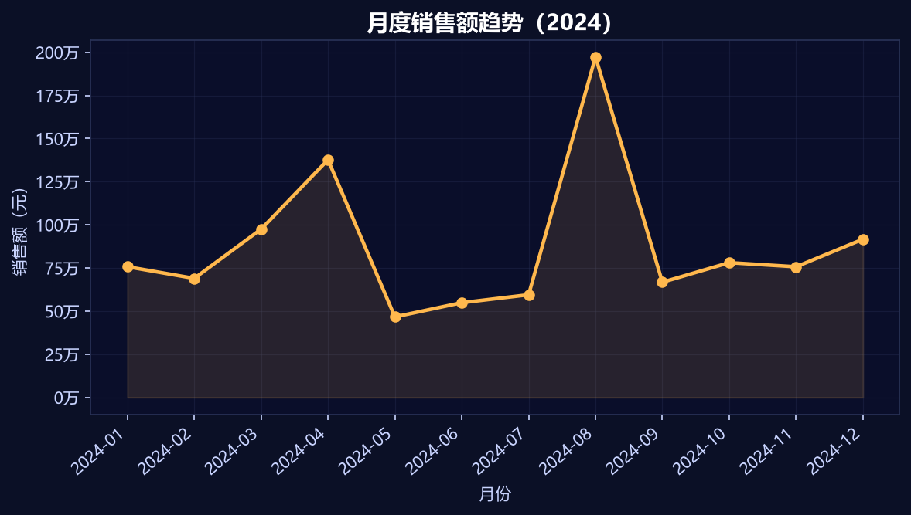
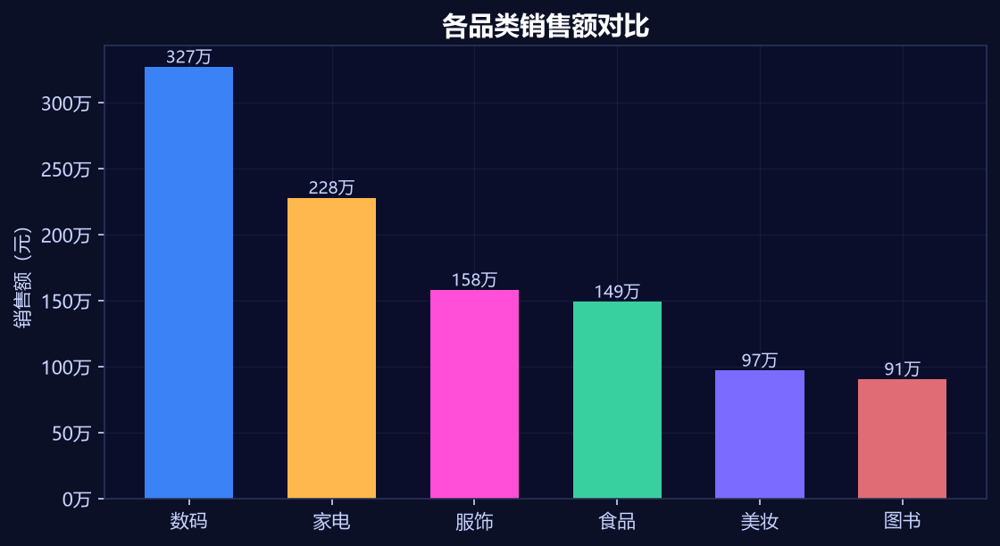
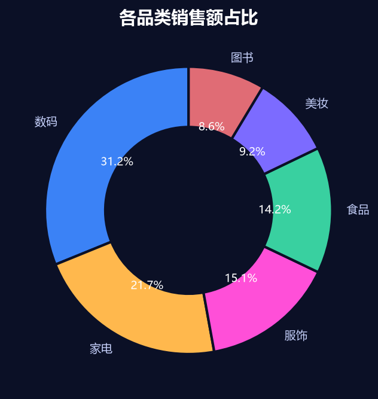
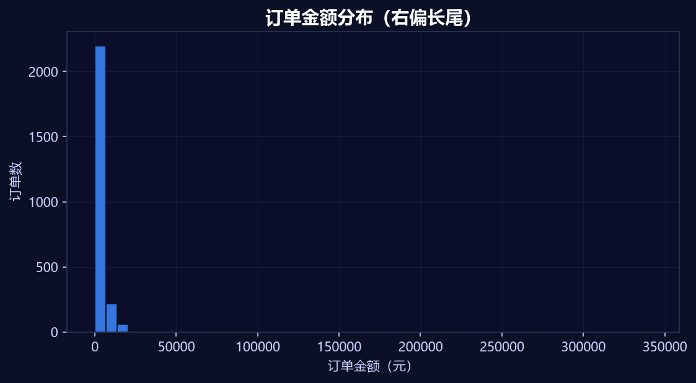
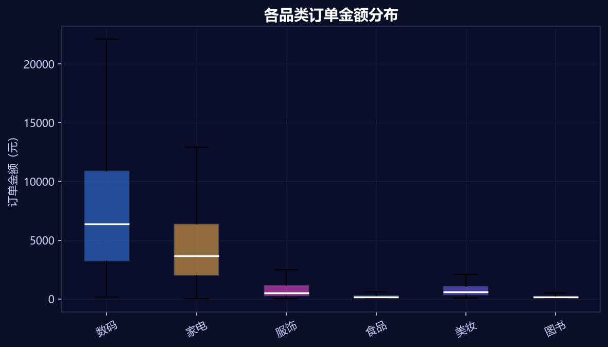
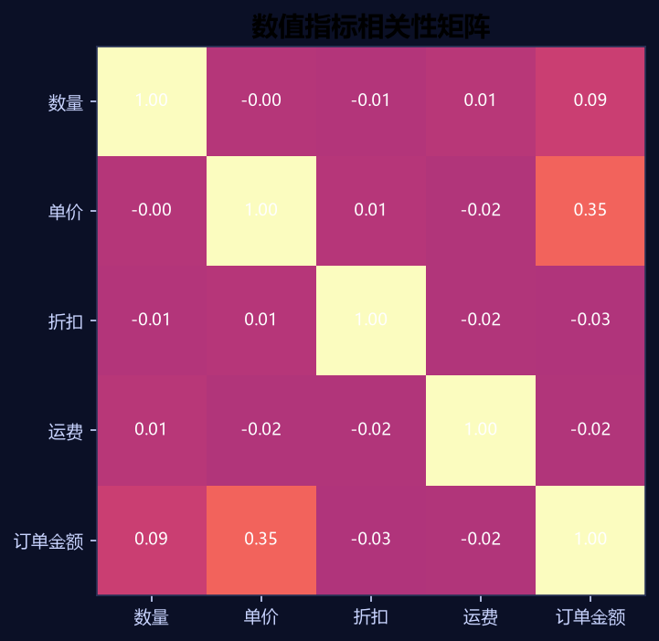
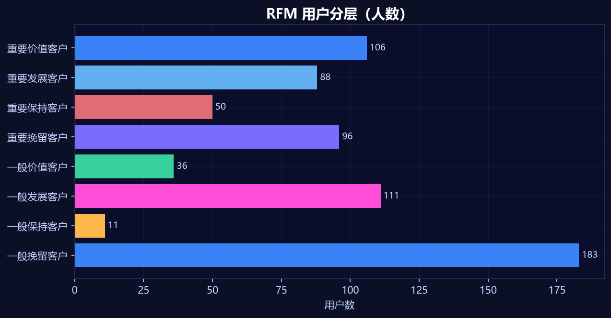
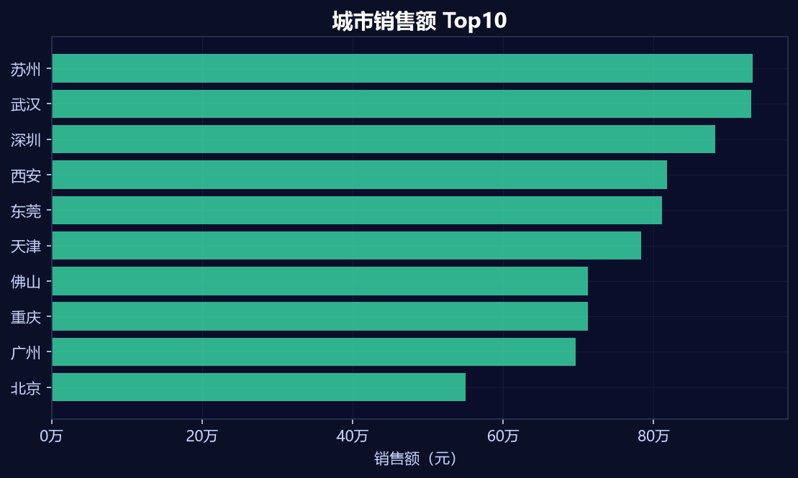
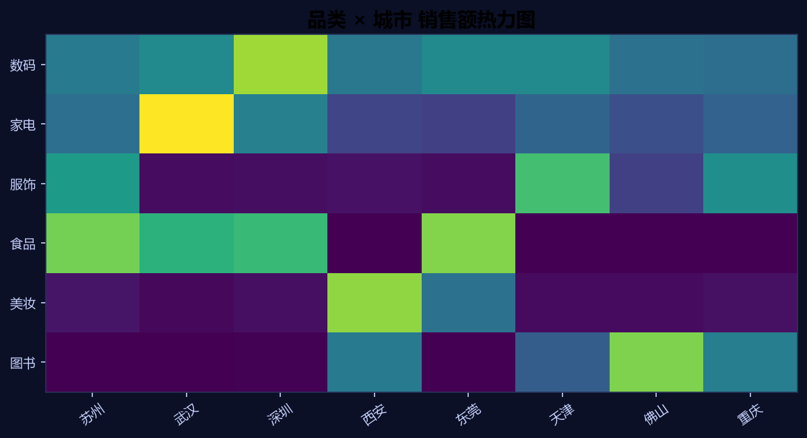

# 🛒 电商销售数据分析与可视化（Python 全流程）

> 一套可直接复现的「脏数据 → 清洗 → 建模 → 可视化 → 业务结论」完整数据分析项目。
> 适合作为数据分析 / 数据运营 / BI 岗位的作品集项目，也适合作为 pandas + matplotlib + seaborn 的系统练习。


---

## 一、项目简介

本项目的目标不是"跑几个图"，而是完整走一遍**企业级电商销售分析**的标准链路：

1. **拿到脏数据**：三张业务表（订单、用户、商品），人为注入缺失值、重复订单、负数、异常单价、混合格式日期、口径混乱等真实问题；
2. **做数据清洗**：缺失值填充、重复值去重、异常值 IQR 截断、日期标准化、文本口径统一；
3. **做数据整合**：多表 `merge`、纵向 `concat`、条件筛选 `query`；
4. **做指标计算**：`groupby` / `agg` / `pivot_table` / `crosstab` / `resample`、环比、客单价、复购率、RFM、帕累托；
5. **做可视化**：matplotlib / seaborn / plotly 三类图表，覆盖趋势、对比、分布、占比、相关性、热力图；
6. **出业务结论**：把数字翻译成可执行的运营建议。

**规模概览**：原始订单 2,640 行 → 清洗后有效订单 **2,509** 单；覆盖 **681** 位下单用户；累计销售额 **1,050.51 万元**。

---

## 二、数据集说明

数据文件：`data/电商销售原始数据.xlsx`（3 个 Sheet）

| 表名 | 行数 | 列名 |
| --- | --- | --- |
| 订单明细表 | 2,640 | 订单号、用户ID、订单日期、商品ID、商品名称、品类、数量、单价、折扣、运费、订单金额、发货城市、订单状态 |
| 用户信息表 | 700 | 用户ID、姓名、性别、年龄、注册日期、会员等级、城市 |
| 商品信息表 | 180 | 商品ID、商品名称、品类、品牌、成本价、上架日期、库存 |

**人为注入的"脏"问题（清洗练习点）**

- 缺失值：`数量`、`订单金额`、`性别`、`年龄`、`会员等级`、`品牌`、`成本价`
- 重复记录：重复订单号、完全重复行
- 异常值：负数数量、离谱单价（如 9,999 元）、超范围折扣
- 日期格式混乱：`2024-01-05`、`2024/1/5`、`20240105`、Excel 序列号混用
- 文本口径混乱：城市出现 `guangzhou` / `广州` / `广东省广州市`；性别 `男/M/male`；会员等级带空格
- 订单状态中英混用：`已完成` / `完成` / `refund` / `退款中`

> 数据集由 `code/01_生成原始数据集.py` 以固定随机种子（2024）生成，**可完全复现**。

---

## 三、技术栈

| 类别 | 工具 | 用途 |
| --- | --- | --- |
| 数据处理 | pandas、numpy | 读取、清洗、合并、分组聚合、透视、RFM |
| 可视化 | matplotlib、seaborn、plotly | 趋势图、柱状图、箱线图、热力图、交互图 |
| 环境 | Jupyter Notebook | 分模块教学与逐段验证 |
| 数据源 | Excel（openpyxl） | 三表原始数据 |

---

## 四、分析流程

```
原始数据（3 表）
   │
   ├─ ① 读取与概览：shape / info / describe / 缺失率
   ├─ ② 数据清洗：缺失填充 → 去重 → 异常 IQR 截断 → 日期标准化 → 文本口径统一
   ├─ ③ 整理合并：订单 + 用户 + 商品 → merge；多期数据 concat；query 过滤
   ├─ ④ 分组聚合：groupby / agg / pivot_table / crosstab / resample + 环比
   ├─ ⑤ 业务指标：客单价 / 件单价 / 复购率 / RFM / 帕累托
   └─ ⑥ 可视化 + 结论：9 张核心图 + 运营建议
```

对应 Notebook：`code/02_学习任务与代码.ipynb`（70 个单元格、51 个代码块，按模块 1→8 递进，每个代码块均有逐行中文注释）。

---

## 五、核心代码

### 5.1 读取三张表

```python
import pandas as pd

DATA_PATH = "data/电商销售原始数据.xlsx"          # Excel 文件路径
订单 = pd.read_excel(DATA_PATH, sheet_name="订单明细表")   # 读订单表
用户 = pd.read_excel(DATA_PATH, sheet_name="用户信息表")   # 读用户表
商品 = pd.read_excel(DATA_PATH, sheet_name="商品信息表")   # 读商品表

print(订单.shape, 用户.shape, 商品.shape)        # 看每张表有多少行多少列
print(订单.isna().mean().sort_values(ascending=False))  # 每列缺失率，从高到低
```

### 5.2 数据清洗（缺失 / 重复 / 异常 / 日期 / 口径）

```python
# 1) 数量缺失 → 用品类中位数填充（同类商品更有可比性）
订单["数量"] = 订单["数量"].fillna(订单.groupby("品类")["数量"].transform("median"))

# 2) 订单金额缺失 → 用业务公式回算：数量 × 单价 ×(1-折扣) + 运费
缺 = 订单["订单金额"].isna()
订单.loc[缺, "订单金额"] = (订单.loc[缺, "数量"] * 订单.loc[缺, "单价"]
                          * (1 - 订单.loc[缺, "折扣"]) + 订单.loc[缺, "运费"])

# 3) 去重：先删完全重复行，再按订单号保留金额最大的一行
订单 = 订单.drop_duplicates()
订单 = 订单.sort_values("订单金额", ascending=False).drop_duplicates("订单号", keep="first")

# 4) 异常值：数量必须 > 0；折扣截断到 [0, 0.3]；单价用 IQR 上界截断
订单 = 订单[订单["数量"] > 0]
订单["折扣"] = 订单["折扣"].clip(0, 0.3)
q1, q3 = 订单["单价"].quantile(0.25), 订单["单价"].quantile(0.75)
上界 = q3 + 1.5 * (q3 - q1)                       # IQR 异常值上界
订单["单价"] = 订单["单价"].clip(upper=上界)        # 超过上界的单价拉回上界

# 5) 日期标准化：混合格式统一转 datetime，转不动的置空后删除
订单["订单日期"] = pd.to_datetime(订单["订单日期"], errors="coerce")
订单 = 订单.dropna(subset=["订单日期"])

# 6) 文本口径统一：城市英文转中文、去"省"、非标准城市归"其他"
城市映射 = {"guangzhou":"广州","shenzhen":"深圳","beijing":"北京","shanghai":"上海",
            "hangzhou":"杭州","chengdu":"成都","wuhan":"武汉","nanjing":"南京"}
订单["发货城市"] = 订单["发货城市"].astype(str).str.strip().str.lower().map(城市映射).fillna(订单["发货城市"])
```

### 5.3 多表合并 + 衍生字段

```python
# 订单表 left join 用户表（补性别、年龄、会员等级、城市）
明细 = 订单.merge(用户, on="用户ID", how="left")

# 再 join 商品表，补品牌与成本价（用 map 按商品ID取成本，比 merge 更轻）
成本映射 = 商品.set_index("商品ID")["成本价"]
明细["成本"] = 明细["商品ID"].map(成本映射)
明细["毛利"] = 明细["订单金额"] - 明细["数量"] * 明细["成本"]   # 毛利 = 收入 - 成本

# 订单月份：转成 2024-01 这种字符串，方便按月分组
明细["订单月份"] = 明细["订单日期"].dt.to_period("M").astype(str)
```

### 5.4 分组聚合、透视、环比

```python
# 按月聚合：总销售额、订单数、总利润、客单价
按月 = 明细.groupby("订单月份").agg(
    总销售额=("订单金额", "sum"),
    订单数=("订单号", "nunique"),        # nunique 去重计数
    总利润=("毛利", "sum"),
    客单价=("订单金额", "mean")
).reset_index()

# 环比：本月 / 上月 - 1
按月["环比"] = 按月["总销售额"].pct_change()

# 品类 × 城市 透视表
透视 = pd.pivot_table(明细, index="品类", columns="发货城市",
                      values="订单金额", aggfunc="sum", fill_value=0)

# 交叉表：会员等级 × 订单状态 的订单数
交叉 = pd.crosstab(明细["会员等级"], 明细["订单状态"])

# 按月重采样（时间序列专用）
月度 = 明细.set_index("订单日期").resample("ME")["订单金额"].sum()
```

### 5.5 业务指标：客单价 / 复购率 / RFM

```python
总销售额 = 明细["订单金额"].sum()
订单数 = 明细["订单号"].nunique()
用户数 = 明细["用户ID"].nunique()
客单价 = 总销售额 / 订单数              # 平均每单金额
件单价 = 总销售额 / 明细["数量"].sum()   # 平均每件金额

# 复购率 = 下过 2 单及以上的用户占比
每人订单数 = 明细.groupby("用户ID")["订单号"].nunique()
复购率 = (每人订单数 >= 2).mean() * 100

# RFM：R 最近一次购买、F 购买频次、M 消费金额
参照日 = 明细["订单日期"].max() + pd.Timedelta(days=1)
rfm = 明细.groupby("用户ID").agg(
    R=("订单日期", lambda x: (参照日 - x.max()).days),
    F=("订单号", "nunique"),
    M=("订单金额", "sum")
)
rfm["R分"] = (rfm["R"] <= rfm["R"].median()).astype(int)   # 最近买过=1
rfm["F分"] = (rfm["F"] >  rfm["F"].median()).astype(int)   # 买得勤=1
rfm["M分"] = (rfm["M"] >  rfm["M"].median()).astype(int)   # 花得多=1
```

### 5.6 可视化

```python
import matplotlib.pyplot as plt

plt.rcParams["font.sans-serif"] = ["Microsoft YaHei"]   # 中文不乱码
plt.rcParams["axes.unicode_minus"] = False              # 负号正常显示

fig, ax = plt.subplots(figsize=(9, 4.2))
ax.plot(月度.index, 月度.values, marker="o", linewidth=2.2)  # 折线 + 数据点
ax.fill_between(range(len(月度)), 月度.values, alpha=0.12)   # 面积阴影
ax.set_title("月度销售额趋势"); ax.set_ylabel("销售额（元）")
plt.setp(ax.get_xticklabels(), rotation=40)                  # x 轴标签倾斜防重叠
plt.savefig("fig/fig01_monthly.png", dpi=150, bbox_inches="tight")
```

---

## 六、运行结果

### 6.1 核心指标

| 指标 | 数值 |
| --- | --- |
| 原始订单 / 清洗后订单 | 2,640 → **2,509** |
| 下单用户数 | **681** |
| 总销售额 | **10,505,068.52 元** |
| 总销量 | **7,618 件** |
| 客单价 | **4,186.95 元** |
| 件单价 | **1,378.98 元** |
| 复购率 | **88.84%** |
| Top 品类 | **数码**（3,272,422.72 元） |
| Top 城市 | **苏州**（931,333.21 元） |

### 6.2 品类汇总

| 品类 | 销售额（元） | 销量 | 订单数 | 客单价（元） |
| --- | ---: | ---: | ---: | ---: |
| 数码 | 3,272,423 | 1,252 | 411 | 7,962 |
| 家电 | 2,280,577 | 1,295 | 428 | 5,328 |
| 服饰 | 1,582,177 | 1,296 | 414 | 3,822 |
| 食品 | 1,492,652 | 1,278 | 429 | 3,479 |
| 美妆 | 971,701 | 1,260 | 411 | 2,364 |
| 图书 | 905,539 | 1,237 | 416 | 2,177 |

### 6.3 可视化结果

**① 月度销售额趋势**：8 月为全年峰值（约 198 万），5 月为低谷（约 47 万），呈明显季节波动。



**② 各品类销售额对比**：数码、家电两品类合计贡献约 53% 销售额，是绝对主力。



**③ 各品类销售额占比**：数码 31.1%、家电 21.7%、服饰 15.1%、食品 14.2%、美妆 9.2%、图书 8.6%。



**④ 订单金额分布**：右偏长尾，多数订单集中在低金额区间，少量大额订单拉高均值。



**⑤ 各品类订单金额分布**：数码品类中位数与离散度均最高，大额订单集中。



**⑥ 数值指标相关性矩阵**：订单金额与数量、单价相关性最高；折扣与订单金额弱负相关。



**⑦ RFM 用户分层**：重要价值客户 106 人、重要发展 88 人、重要保持 50 人、重要挽留 96 人；一般挽留客户 183 人，是需要重点唤醒的存量池。



**⑧ 城市销售额 Top10**：苏州、广州、深圳等城市贡献主要销售额。



**⑨ 品类 × 城市热力图**：数码在多数城市均为第一贡献品类，区域结构差异清晰。



---

## 七、业务结论与建议

1. **品类结构**：数码 + 家电贡献过半销售额，应作为主推与库存保障重点；图书、美妆客单价低，适合做拉新与凑单。
2. **季节节奏**：8 月峰值、5 月低谷，建议在大促前 1 个月提前备货，并把 5 月作为清库存与会员唤醒窗口。
3. **用户运营**：复购率 88.84% 说明用户粘性较好，但"一般挽留客户"183 人占比高，建议用优惠券 + 召回短信做分层触达。
4. **区域策略**：苏州、广州、深圳为核心市场，可优先投放；低贡献城市通过运费策略与品类组合提升客单。
5. **价格与折扣**：折扣与订单金额弱负相关，说明"打折不一定带来更高客单"，应避免无底线折扣，转向满减/组合套餐提升件单价。

---

## 八、目录结构

```
ecommerce-sales-analysis/
├─ README.md
├─ data/
│  └─ 电商销售原始数据.xlsx        # 三表原始脏数据
├─ code/
│  ├─ 01_生成原始数据集.py         # 固定种子生成数据（可复现）
│  ├─ 02_构建学习任务Notebook.py   # 生成教学 Notebook
│  ├─ 02_学习任务与代码.ipynb      # 70 单元格完整教学代码
│  ├─ 03_生成结果图.py             # 清洗+分析+出图脚本
│  └─ 分析摘要.json                # 关键指标汇总
└─ fig/
   ├─ fig01_monthly.png ~ fig09_heat.png   # 9 张结果图
```

---

## 九、如何运行

```bash
# 1. 安装依赖
pip install pandas numpy matplotlib seaborn openpyxl jupyter

# 2. （可选）重新生成数据集
python code/01_生成原始数据集.py

# 3. 一键清洗 + 分析 + 出图
python code/03_生成结果图.py

# 4. 打开教学 Notebook 逐模块学习
jupyter notebook code/02_学习任务与代码.ipynb
```

> 运行环境：Python 3.10+，Windows / macOS 均可；图表已适配中文字体，Linux 下如中文乱码请安装 `Noto Sans CJK` 并修改 `font.sans-serif`。

---

## 十、可迁移能力（面试可讲）

- **数据清洗**：缺失值策略（中位数/公式回算）、去重策略（业务主键 + 保留规则）、异常值检测（IQR）、日期与文本口径统一；
- **数据整合**：多表 join 的键选择、`map` 替代 merge 的性能取舍、纵向 concat 与条件过滤；
- **指标体系**：客单价、件单价、复购率、RFM、帕累托，能把"指标"翻译成"动作"；
- **可视化表达**：按"趋势 / 对比 / 分布 / 占比 / 相关 / 结构"选图，而不是堆图；
- **工程可复现**：固定随机种子、脚本化出图、Notebook 分模块验证，保证别人拿到能跑通。

---

*本项目为个人学习与作品集用途，数据为程序生成的模拟电商数据，不含任何真实用户信息。*
